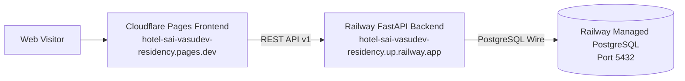

# Hotel Sai Vasudev Residency — Railway Cloud Deployment Guide

This guide details how to deploy the **FastAPI Backend** and **PostgreSQL Database** on [Railway Cloud](https://railway.com/) and link it to your **Cloudflare Pages Frontend**.

---

## 🏗️ Architecture Overview



---

## 🚀 Step-by-Step Railway Deployment

### Step 1: Create a Railway Project & Add PostgreSQL
1. Open your Railway dashboard: [railway.com/dashboard](https://railway.com/dashboard)
2. Click **"+ New Project"**.
3. Select **"Provision PostgreSQL"** (or click **"+ New"** -> **"Database"** -> **"Add PostgreSQL"**).
4. Railway will spin up a dedicated PostgreSQL database and automatically create connection variables (`DATABASE_URL`, `PGHOST`, etc.).

---

### Step 2: Add the FastAPI Backend Service
1. In the same project canvas, click **"+ New"** -> **"GitHub Repo"**.
2. Select your repository: **`nandyalanamahshivaya99/hotel-sai-vasudev-residency`**.
3. Railway will create a new service card.

---

### Step 3: Configure Backend Service Settings

Click on the newly created service card to open its settings:

#### 1. Set Root Directory
- Open the **Settings** tab.
- Scroll down to the **Source** section.
- Set **Root Directory** to:
  ```text
  /backend
  ```
- *(Railway will now build directly from `/backend` using `railway.json` and `requirements.txt`).*

#### 2. Set Environment Variables
- Open the **Variables** tab.
- Add the following two environment variables:

| Variable Name | Value | Description |
|---|---|---|
| `DATABASE_URL` | `${{Postgres.DATABASE_URL}}` | References live Railway PostgreSQL credentials |
| `ALLOWED_ORIGINS` | `https://hotel-sai-vasudev-residency.pages.dev,http://localhost:5173` | Allows Cloudflare Pages and local testing |

*(Tip: In Railway, typing `${{` in the value field opens an autocomplete menu to select `Postgres.DATABASE_URL`).*

#### 3. Generate Public Domain
- Open the **Settings** tab -> **Networking**.
- Under **Public Networking**, click **"Generate Domain"**.
- Railway will provide a URL such as:
  ```text
  https://hotel-sai-vasudev-residency-production.up.railway.app
  ```

---

### Step 4: Verify Deployment Health

Once the build finishes:

1. **Healthcheck Endpoint**:
   ```
   https://<your-railway-domain>.up.railway.app/health
   ```
   Expected response:
   ```json
   {
     "status": "healthy",
     "database": "connected",
     "engine": "PostgreSQL"
   }
   ```

2. **Interactive Swagger API Documentation**:
   ```
   https://<your-railway-domain>.up.railway.app/api/v1/docs
   ```
   - On the first request, the database automatically initializes tables (`rooms`, `bookings`, `inquiries`) and seeds the initial room catalog.

---

### Step 5: Connect Frontend (Cloudflare Pages)

1. Open your [Cloudflare Dashboard](https://dash.cloudflare.com/) -> **Workers & Pages**.
2. Click on **`hotel-sai-vasudev-residency`**.
3. Go to **Settings** -> **Environment variables**.
4. Click **"Add variable"**:
   - **Variable name**: `VITE_API_BASE_URL`
   - **Value**: `https://<your-railway-domain>.up.railway.app/api/v1`
5. Go to **Deployments** -> Click **"Retry deployment"** (or push a new commit).
6. Your live frontend will now communicate directly with your Railway FastAPI & PostgreSQL backend!
